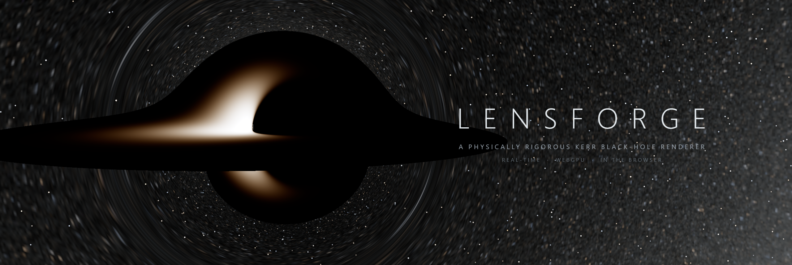
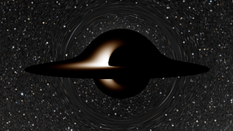
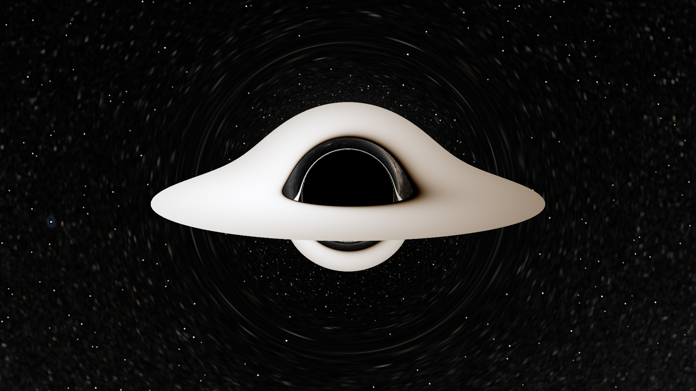
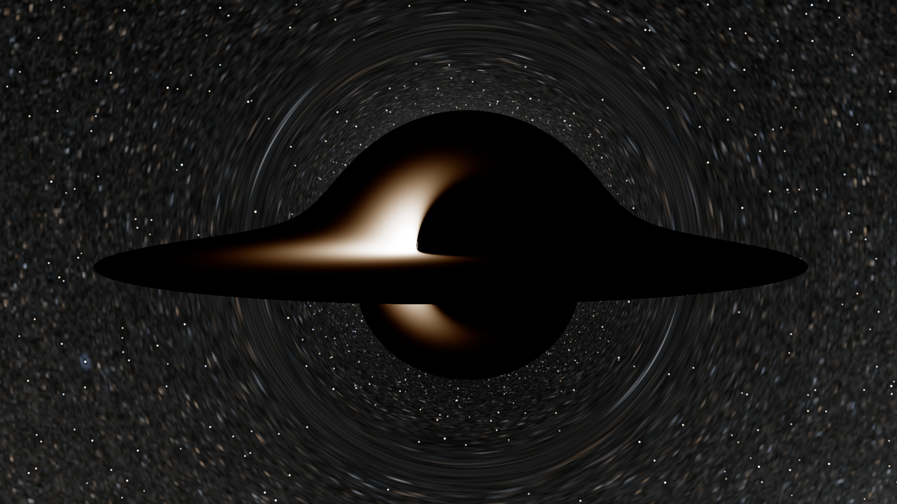
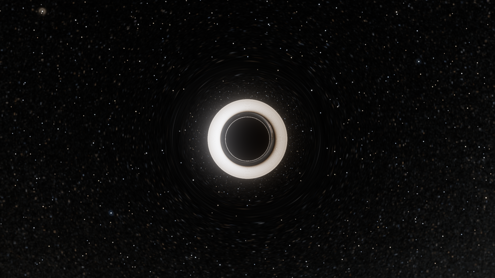
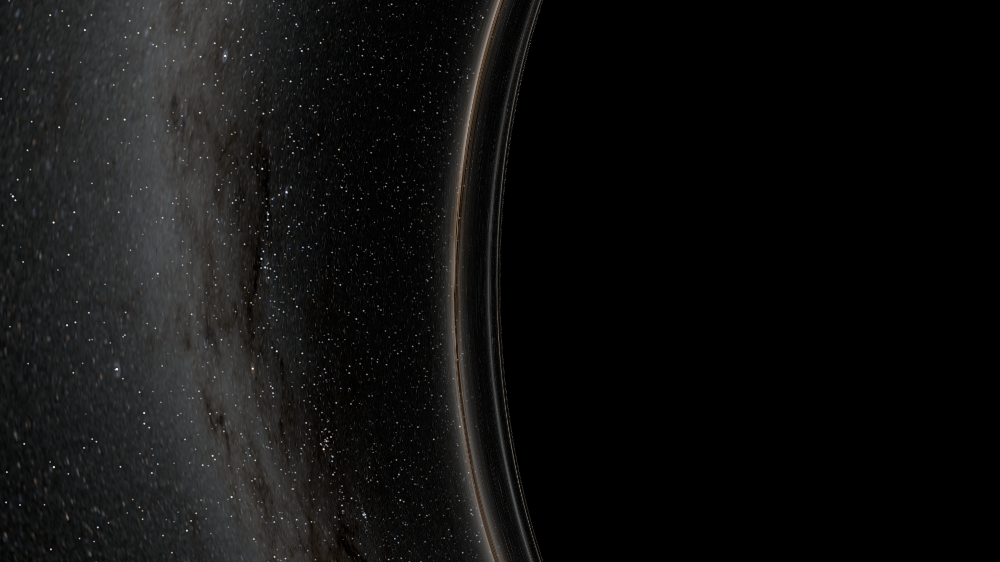
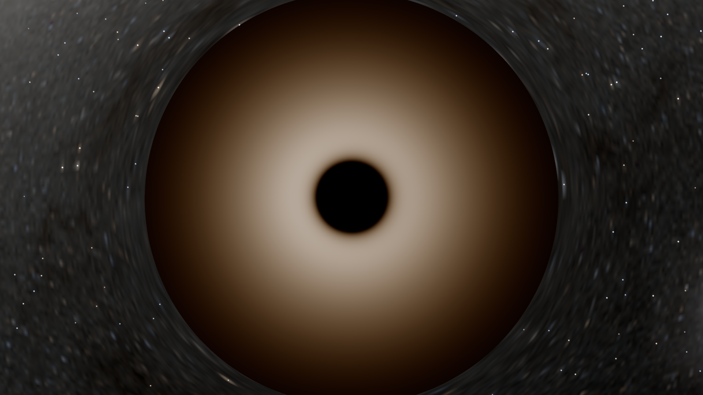
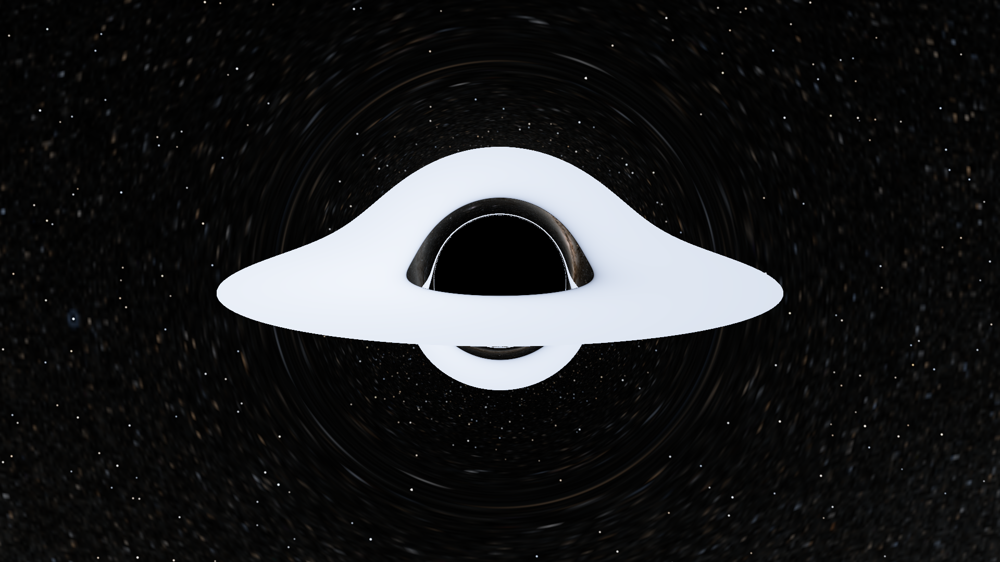

<div align="center">



<br/>

**Every pixel is a numerically integrated null geodesic of the Kerr metric.**
<br/>
Nothing is faked, painted, or approximated for artistic effect — and every claim is measured.

<br/>

[](CHANGELOG.md)
[](LICENSE)
[](https://www.w3.org/TR/webgpu/)
[](VALIDATION.md)

<br/>



*A full camera orbit at spin a = 0.998 — frame dragging, Doppler beaming, and the lensed*
*secondary disk image, each frame fully converged. Rendered live in the browser.*

</div>

---

LensForge renders a Kerr black hole by backward ray tracing: for every pixel,
a null geodesic is integrated through curved spacetime on the GPU (WGSL
compute, adaptive Dormand–Prince 4(5) in Hamiltonian form), then shaded with
exact relativistic radiometry — a Novikov–Thorne thin accretion disk at the
exactly redshifted and beamed temperature `T_obs = g·T_eff`, and the real
celestial sphere, where star positions, brightnesses, and lensing
magnifications are computed, not painted.

The event-horizon shadow, photon ring, Einstein rings, frame dragging,
gravitational redshift, and beaming asymmetry are never implemented as
"effects." They **emerge** from two components — a geodesic integrator and a
radiative-transfer pipeline — or they don't appear at all.

What makes this trustworthy rather than merely pretty:

- **A float64 CPU oracle** (`src/physics/`) implements the identical physics
  and is tested against closed-form general relativity — metric identities,
  the critical impact parameter `3√3 M`, weak-field deflection series,
  ISCO/photon orbits, Page–Thorne flux — in CI on every commit (70 tests).
- **The float32 GPU code is confronted with the oracle** on identical rays:
  escape directions agree to better than **1 arcminute** and disk-hit
  redshift factors to **Δg/g ≤ 10⁻⁴** at spins up to the Thorne limit.
- **Rendered images are confronted with the literature**: the shadow
  silhouette lies within **half a pixel** of Bardeen's analytic contour; disk
  geometry reproduces Luminet's 1979 photograph; beaming morphology follows
  DNGR (*Interstellar*'s renderer — with beaming kept on).
- Every accuracy boundary is documented in [PHYSICS.md](PHYSICS.md) §10,
  measured in [VALIDATION.md](VALIDATION.md), and surfaced to users in the
  in-app **About & accuracy** panel.

## Gallery

| | |
|:---:|:---:|
|  |  |
| ***Luminet 1979*** — Schwarzschild, disk viewed 10° above the plane: the geometry of the first-ever computed black-hole image | ***DNGR Gargantua*** — a = 0.998, near-edge-on: extreme Doppler beaming darkens the receding side |
|  |  |
| **Startup view** — edge-on Schwarzschild; the razor-thin disk seen only through its lensed image, with the statistical turbulence model advected at the exact Ω(r) | ***Photon-ring grazing*** — the sky piles into infinitely many images against the critical curve |
|  |  |
| ***Face-on*** — a = 0.9 from above the pole: ISCO truncation and the central shadow | **Physical color mode** — true blackbody chromaticity at `T_obs = g·T_eff` through a Planck → CIE XYZ pipeline |

*All images are unretouched application output (see [docs/media/](docs/media/README.md) for exact provenance). The
scientifically authoritative renders are the [validation goldens](docs/figures/presets/).*

## Features

- **Full Kerr spacetime**, spin `a ∈ [0, 0.998]` — Schwarzschild is just `a = 0`.
- **Novikov–Thorne thin disk** (Page–Thorne flux, ISCO-truncated) with exact
  redshift, beaming, and aberration via orthonormal tetrads and the `I_ν/ν³`
  invariant; physical and temperature-scaled color calibrations, both labeled.
- **Real sky**: NASA Deep Star Maps 2020 cubemap plus the Yale Bright Star
  Catalogue re-emitted as analytic point sources under computed `|det J|⁻¹`
  magnification — stars sweep, brighten, and multiply under lensing without
  aliasing.
- **Observers with correct kinematics**: ZAMO, static (ergosphere-guarded),
  and circular orbit — the orbiting camera carries its full `v ≈ 0.35c`
  aberration.
- **Interactive → converged**: progressive refinement with temporal
  accumulation produces an exact converged still whenever the camera rests;
  every intermediate frame is honest traced radiance for the current pose.
- **HDR throughout**, AgX tone mapping, exposure in stops; optional
  energy-conserving bloom (display-only, off by default).
- **Export**: PNG screenshots and tiled export up to 8K that is bit-identical
  to a monolithic render — same code path, more samples.
- **Reproducible states**: presets serialize the full parameter + camera
  state to canonical JSON; the shipped presets double as the validation
  framings.
- **Robust GPU citizenship**: every dispatch is bounded (no OS watchdog
  resets), device loss recovers automatically, and a startup micro-benchmark
  picks the fastest workgroup size for your adapter.

## Validation at a glance

The v1.0.0 measured record — raw JSON in [docs/results/m8/](docs/results/m8/),
figures in [docs/figures/](docs/figures/), definitions and tolerances in
[VALIDATION.md](VALIDATION.md):

| Confrontation | Measured (v1.0.0) | Bound |
|---|---|---|
| GPU f32 vs f64 oracle — escape direction (High tier, `a = 0 / 0.9 / 0.998`) | 0.052′ / 0.159′ / 0.99′ | 1′ |
| GPU f32 vs f64 oracle — disk-hit redshift factor | `Δg/g ≤ 1.03e−4` | `1e−3` |
| Rendered shadow vs Bardeen analytic contour (4 spins) | ≤ 0.50 px | 1 px |
| Disk-image boundary vs oracle at the Luminet 1979 framing | 166/166 matched, ≤ 0.62 px | 1 px |
| Beaming asymmetry vs full float64 re-shade | ≤ 5.7e−5 | 5 % |
| Star-splat magnification vs oracle ray-bundle Jacobian | ≤ 0.25 % | 5 % |
| Golden-image regression (SSIM + pre-tonemap HDR statistics) | SSIM = 1.0, ΔL = 0 | > 0.99, < 1 % |
| Step-budget exhaustion across all presets | 0 pixels | < 0.1 % |

Where the renderer *cannot* be trusted is documented with the same rigor:
photon subrings of order `n ≥ 2` are below float32 impact-parameter
resolution, near-critical rays are chaotically sensitive (reported, not
bounded), and the disk is a time-averaged model, not GRMHD
([VALIDATION.md §7](VALIDATION.md#7-known-limitations)).

## Quick start

Requirements: **Node ≥ 20** and a **WebGPU browser** — Chrome/Edge ≥ 113,
Firefox ≥ 141, or Safari ≥ 26 (desktop).

```bash
npm install
npm run dev        # Vite dev server → open in a WebGPU browser
```

```bash
npm test           # 70-test CPU physics suite (no GPU needed)
npm run typecheck  # strict TypeScript
npm run build      # static production build (dist/)
```

The production build is fully static — host `dist/` anywhere. GPU-dependent
validation runs in the browser via the dev-build `__lensforge` console hooks;
the complete procedure is in [docs/README.md](docs/README.md).

## Controls

| Input | Action |
|---|---|
| Drag | Orbit the black hole (or free-look, in *Free look* mode) |
| Scroll wheel | Dolly the camera radius |
| `H` | Hide/show the control panel |
| Control panel | Spin, observer, quality, camera, disk (Ṁ, extent, colors, turbulence), exposure, bloom, time scale |
| Presets | Apply the shipped scientific framings, or save/load exact states as JSON |
| Export | PNG screenshot, or tiled render up to 7680 × 4320 |

The **About & accuracy** button states, in plain language, exactly what you
are seeing and where its accuracy ends.

## How it works

```
Pass A  RAY INIT        pixel → observer tetrad → (x^μ, p_μ)  per-ray state (SoA)
Pass B  GEODESIC MARCH  chunked adaptive DP4(5) Hamiltonian steps until
                        CAPTURED | ESCAPED | HIT_DISK   (TDR-safe, checkpointable)
Pass C  SHADE           ESCAPED  → star-subtracted sky cubemap + analytic star
                                   splats × |det J|⁻¹
                        HIT_DISK → Planck(T_eff(r)) · g³ → CIE XYZ → linear sRGB
Pass D  POST            temporal accumulation → exposure → AgX → present / export
```

Two independent implementations of the same formulation keep each other
honest: the float64 TypeScript oracle is validated against closed forms, and
the float32 WGSL port is validated against the oracle — disagreement beyond
tolerance blocks merge. All real-time work happens on the GPU; the CPU owns
parameters, camera, and precomputation only.

Module boundaries, the frame-budget governor, the preview ladder, and all
twelve binding design decisions (`D1`–`D12`): [ARCHITECTURE.md](ARCHITECTURE.md).

## Performance

Interactive at 1080p-equivalent adaptive quality on discrete GPUs (the
project's V-P1 target: 60 fps on an RTX 4070 Ti; measured steady-state march
3.4 ms at 1080p on the development GPU). Still-frame convergence after the
camera rests: 40 ms at `a = 0.9`, 220 ms at `a = 0.998` (bound: 2 s). A
1080p tiled export with 8 AA samples completes in ~2 s. Integrated GPUs run
degraded-but-correct via quality tiers whose accuracy is separately
validated (Medium 1.83′, Low 2.51′ vs the oracle). Numbers:
[VALIDATION.md §4](VALIDATION.md#4-performance-validation-v-p).

## Repository map

| Path | Contents |
|---|---|
| [`src/physics/`](src/physics/) | Float64 reference physics — the scientific oracle |
| [`src/shaders/`](src/shaders/) | WGSL kernels (validated float32 ports of `src/physics/`) |
| [`src/gpu/`](src/gpu/) | WebGPU device layer, pipelines, profiler |
| [`src/renderer/`](src/renderer/) | Frame graph, chunk scheduler, accumulation, export |
| [`src/scene/`](src/scene/) · [`src/sim/`](src/sim/) · [`src/ui/`](src/ui/) | Camera & presets · clock & parameter store · panel |
| [`src/validation/`](src/validation/) | GPU-vs-oracle harness (never ships in the bundle) |
| [`tests/`](tests/) | V-A physics suite + committed golden images |
| [`tools/`](tools/) | Offline asset/LUT generation (sky, flux, Planck→XYZ) |
| [`docs/`](docs/README.md) | The auditable v1.0.0 validation record + media |

## Documentation

| Document | Read it for… |
|---|---|
| [MASTER_PLAN.md](MASTER_PLAN.md) | Scope, philosophy, non-goals — the source of truth for *what* and *why* |
| [PHYSICS.md](PHYSICS.md) | Every equation, unit convention, and accuracy boundary |
| [ARCHITECTURE.md](ARCHITECTURE.md) | Module boundaries, GPU pipeline, design decisions `D#` |
| [VALIDATION.md](VALIDATION.md) | Test definitions `V-*`, tolerances, and the measured record |
| [IMPLEMENTATION.md](IMPLEMENTATION.md) | The M0–M8 milestone roadmap the project was built by |
| [DEVELOPMENT.md](DEVELOPMENT.md) | Coding standards, workflow, debugging, deployment |
| [REFERENCES.md](REFERENCES.md) | Canonical literature citations `[R#]` |

Cross-reference convention: `[R#]` cites REFERENCES.md, `D#` a design
decision, `V-*` a validation test, `M#` a milestone. Each fact lives in
exactly one document.

## Roadmap

v1.0.0 is complete and validated. The architecture deliberately leaves seams
for ([ARCHITECTURE.md §9](ARCHITECTURE.md#9-future-scalability)): a df64
double-float offline mode to resolve `n ≥ 2` photon subrings, free-fall
cameras on timelike geodesics, an EXR/float export path, volumetric disks fed
by imported GRMHD snapshots, relativistic jets, and spectral rendering.
Deliberate non-goals (GRMHD simulation, polarization, WebGL2 fallback,
mobile-first) are recorded in [MASTER_PLAN.md §4](MASTER_PLAN.md#4-non-goals).

## Contributing

Contributions are welcome — physics first, validation always. Read
[CONTRIBUTING.md](CONTRIBUTING.md); the short version is that physics changes
land in the float64 oracle with unit tests before their WGSL port, and
anything touching accuracy ships with its measured V-O report. If you believe
an image is physically wrong, the *Physics discrepancy* issue template is the
most valuable report this project can receive.

## Citation

If LensForge or its validation methodology is useful in academic work, please
cite it ([CITATION.cff](CITATION.cff)):

```bibtex
@software{lensforge2026,
  title   = {LensForge: a physically rigorous real-time Kerr black-hole
             renderer for the browser},
  author  = {{The LensForge Authors}},
  year    = {2026},
  version = {1.0.0},
  license = {MIT},
  note    = {WebGPU; float64-oracle-validated general-relativistic
             ray tracing with exact radiative transfer}
}
```

## Acknowledgements & data

- **Sky panorama**: NASA/GSFC Scientific Visualization Studio,
  [*Deep Star Maps 2020*](https://svs.gsfc.nasa.gov/4851) (public domain).
- **Bright stars**: [Yale Bright Star Catalogue, 5th revised ed.](http://tdc-www.harvard.edu/catalogs/bsc5.html)
  (Hoffleit & Warren 1991) — measured photometrically in the panorama and
  re-emitted as analytic sources in one consistent radiometric system.
- **Tone mapping**: Troy Sobotka's [AgX](https://github.com/sobotka/AgX).
- **Standing on**: Bardeen (1973), Luminet (1979), Page & Thorne (1974),
  Cunningham (1975), and James, von Tunzelmann, Franklin & Thorne (2015) —
  the DNGR paper. Full citations: [REFERENCES.md](REFERENCES.md).

## License

[MIT](LICENSE) for all code. Bundled sky data is public domain / freely
redistributable catalog data, attributed in-app and in
[REFERENCES.md](REFERENCES.md).
